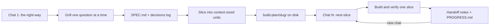

# The Right Way

**Grill the plan until it's airtight. Then build it one fresh chat at a time.**

[](https://github.com/131ackknight/the-right-way/actions/workflows/validate.yml)
[](LICENSE)


The Right Way is a pair of [Agent Skills](https://agentskills.io) for AI coding agents. The first one interviews you until every important decision is made. Then it cuts the work into **slices**, each small enough to build inside a single chat's context window, and writes everything to disk. The second skill builds one slice per fresh chat and leaves clean handoff notes for the next one.

No chat ever runs long enough to get its context compacted, and no decision lives only in a conversation you can't get back to.

## The problem

Long agent sessions degrade. Once a chat fills its context window, the agent compacts or summarizes the history, and the details go first: the edge case you agreed on, the reason you picked one library over another, the function signature an earlier step settled on. The agent then works confidently from a lossy memory.

Interview-style skills like [Grill Me](https://github.com/mattpocock/skills) fix the planning side: they make the agent ask hard questions before writing code. But the resulting plan still lives in one long conversation, and the build happens in that same conversation until it falls over.

The Right Way keeps the grilling and moves the memory out of the chat and into files.

## How it works



### 1. `the-right-way`: grill, slice, write the build pack

- **Grills one question at a time**, always with a recommended answer, so you can reply "yes" and move on. It reads your codebase first, so it never asks what the code already answers.
- **Logs every decision** (`D-001`, `D-002`, ...), with the reason and whether you decided it or said "your call". It writes them to disk in batched checkpoints rather than after every answer, so the gap between questions stays short and the planning chat doesn't fill up with file edits. The planning chat can itself be resumed in a new chat if it runs long.
- **Slices the work** into vertical, independently verifiable units with a context budget: roughly 8 files touched or fewer, about 5 files to read, one testable outcome.
- **Connects slices through contracts, not memories.** Each brief spells out the exact signatures, routes, and types it **consumes** and **produces**. A brief can never say "as discussed".
- **Writes a build pack** to `build-plan/<slug>/`, one folder per planned effort, so several features can be planned and built side by side. It prints a kickoff prompt naming the exact slice and folder.

### 2. `next-slice`: build one slice per fresh chat

- Builds the slice the kickoff prompt names, or the next ready one. It claims the slice in `PROGRESS.md` and never takes over a slice another chat is working on. It loads **only** that brief plus the files it lists.
- Checks the consumed contracts exist on disk before writing a line of code.
- Builds, then runs the slice's verify commands. It never marks a slice done with failing checks.
- Writes a **handoff**: what changed, deviations, and changed contracts. It then updates the briefs of any downstream slices so the next chat codes against reality.
- **Splits instead of sprawling.** If a slice grows past its budget, it stops at a clean point and writes the remaining work as new slices.
- Prints a kickoff prompt for each slice that is ready now, so parallel chats each get their own.

## The build pack

```
build-plan/
  streaks/             # one folder per planned effort
    SPEC.md            # requirements with acceptance criteria, data model, decisions log
    PROGRESS.md        # slice table: status, dependencies, parallel-safe pairs. The source of truth.
    slices/
      01-foundation.md
      02-manage-habits.md
      03-check-ins-and-streaks.md
      ...
  another-feature/     # a second effort, planned and built independently
```

Every slice brief has the same sections: **Goal**, **Read first**, **Consumes**, **Produces**, **Tasks**, **Acceptance criteria**, **Verify**, **Out of scope**, and **Handoff**. See the [templates](skills/the-right-way/templates/).

## See it in action

[`examples/habit-tracker`](examples/habit-tracker/) is a complete build pack for a small app, frozen mid-build:

- [SPEC.md](examples/habit-tracker/build-plan/streaks/SPEC.md): six requirements and ten logged decisions.
- [PROGRESS.md](examples/habit-tracker/build-plan/streaks/PROGRESS.md): two slices done, slice 03 next, and slice 04 safe to run in parallel.
- [Slice 02](examples/habit-tracker/build-plan/streaks/slices/02-manage-habits.md): the builder changed a contract, explained why in the handoff, and updated the downstream briefs.
- [Slice 03](examples/habit-tracker/build-plan/streaks/slices/03-check-ins-and-streaks.md): what the next fresh chat will read. It already reflects slice 02's change.

The [example README](examples/habit-tracker/README.md) includes an excerpt of the grilling.

## Install

### Claude Code (plugin)

```
/plugin marketplace add 131ackknight/the-right-way
/plugin install the-right-way@the-right-way
```

### Any tool (script)

```bash
git clone https://github.com/131ackknight/the-right-way.git
cd the-right-way
./scripts/install.sh            # auto-detects Claude Code, Cursor, and Codex
./scripts/install.sh --all      # or install for all three
./scripts/install.sh --cursor --project   # into the current project only
./scripts/install.sh --all --link         # symlink, so `git pull` updates the skills
```

| Tool | User install | Project install |
| --- | --- | --- |
| Claude Code | `~/.claude/skills/` | `.claude/skills/` |
| Cursor | `~/.cursor/skills/` | `.cursor/skills/` |
| Codex | `~/.agents/skills/` | `.agents/skills/` |

### Manual

Copy `skills/the-right-way/` and `skills/next-slice/` into your tool's skills folder from the table above.

## Usage

**Plan** (in a new chat):

```
Use the-right-way to plan a local-first habit tracker with streaks.
```

Answer the questions. When the plan is confirmed, the agent writes `build-plan/<slug>/` and gives you a kickoff prompt.

**Build** (in a new chat for each slice). Paste the prompt the agent printed; it names the exact slice and folder:

```
Use the next-slice skill to build slice 01 of build-plan/habit-tracker/.
```

Each finished slice prints the next prompt. When two slices can run in parallel, you get one prompt per slice: paste each into its own chat. With several efforts in one repo, the folder in the prompt keeps them apart. If you leave out the slice number, the agent picks the next ready slice; if you leave out the folder and there are several, it asks which one.

## Design principles

1. **Files over memory.** If a decision isn't written down, it didn't happen.
2. **Recommend, then ask.** Every question comes with a default, so grilling is fast.
3. **Contracts over context.** Slices share exact interfaces, not conversation history.
4. **Budget every chat.** A slice must fit in about half a context window, which leaves room to debug.
5. **Split, don't sprawl.** Running over budget produces new slices, not a longer chat.
6. **Verify before done.** Every slice ships with commands that prove it works.
7. **Every line is read many times.** Skill descriptions stay short because they load into every chat. Templates carry no boilerplate. Briefs cite spec IDs instead of copying text. Builders batch their reads, run each check once with quiet output, and do their bookkeeping in a few combined edits.

## Repository layout

```
skills/
  the-right-way/       SKILL.md + templates (SPEC, PROGRESS, slice)
  next-slice/          SKILL.md
examples/habit-tracker/ a mid-build example build pack
.claude-plugin/        Claude Code plugin and marketplace manifests
scripts/
  install.sh           installer for Claude Code, Cursor, and Codex
  validate.mjs         checks skill frontmatter, manifests, and example packs against the templates
```

## Development

```bash
node scripts/validate.mjs
```

The validator needs no dependencies. It checks each `SKILL.md` against the Agent Skills rules: the name matches its folder, the description is within limits, and links resolve. It also checks the plugin manifests, and that every example build pack contains every section its template defines. CI runs it on every push.

## License

[MIT](LICENSE)
